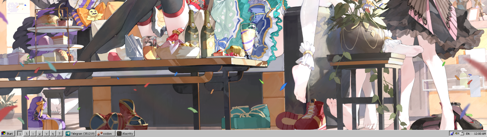
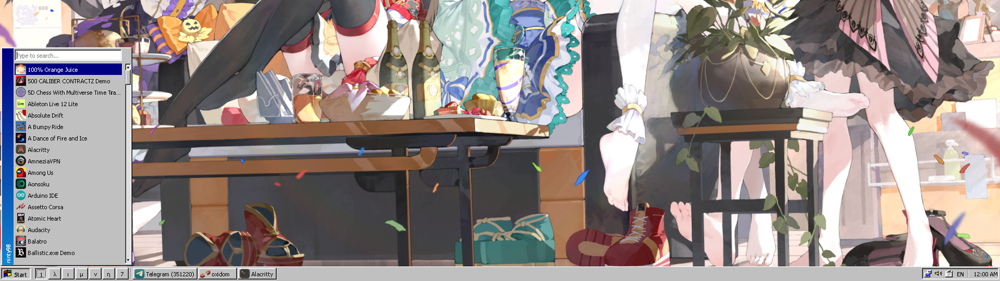
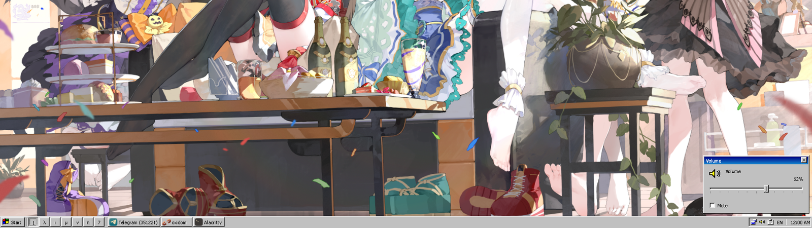
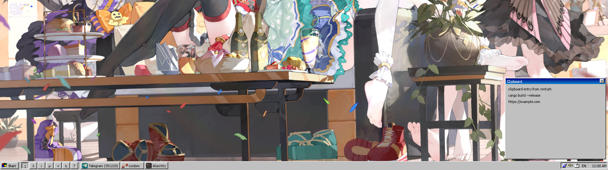
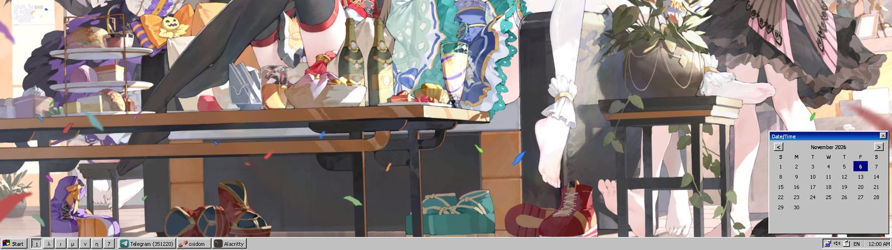
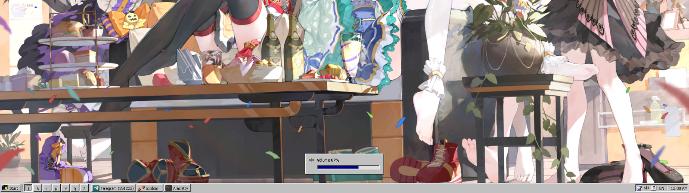

# nintysh

This is a vibecoded Windows 98-style Wayland shell for niri.

It is not production software. You probably shouldn't touch this.

No support. No guarantees. It works on my machine.

## Actual documentation

### Screenshots

| Desktop | Launcher |
| --- | --- |
|  |  |

| Volume | Clipboard |
| --- | --- |
|  |  |

| Calendar | OSD |
| --- | --- |
|  |  |

### Requirements

- Linux with Wayland
- niri
- GTK4 + gtk4-layer-shell
- `wl-clipboard` for clipboard history
- `wpctl` for volume control
- a system battery exposed through `/sys/class/power_supply` for the battery widget

Nix users get the GTK/JSON/wl-clipboard dependencies from the flake.

### Build and run

```bash
just build
just run
```

With Nix:

```bash
nix build .#
nix run .#
nix develop
```

The shell is a layer-shell client. Start it inside a running niri session.

### Features

- Win98-style taskbar with Start menu, workspaces, window tasks and system tray
- Launcher with typed search, keyboard navigation and app icons
- `/` prefix in the launcher runs a shell command
- Volume panel with slider, mute checkbox and OSD
- Calendar panel
- Network and battery information panels
- Clipboard history panel with click-to-copy
- Right-click task menu: focus, floating, fullscreen, close
- Per-monitor taskbars
- Multi-monitor window/workspace filtering
- Clock, volume, network, battery and keyboard-layout indicators

### CLI control

The running shell listens on:

```text
$XDG_RUNTIME_DIR/nintysh-$WAYLAND_DISPLAY.sock
```

Override with `NINTYSH_SOCKET`.

```bash
nintysh msg launcher
nintysh msg close
nintysh msg volume
nintysh msg volume up
nintysh msg volume down
nintysh msg volume 40
nintysh msg volume mute
nintysh msg calendar
nintysh msg network
nintysh msg clipboard
nintysh msg power
nintysh msg layout
nintysh msg workspace 2
nintysh msg osd "Hello"
nintysh msg run 'foot -e btop'
```

### Configuration

Compile-time settings live in:

- `src/config.h`
- `src/config.user.h`

`config.h` includes `config.user.h` first, then provides defaults guarded by `#ifndef`. You can edit either file directly or provide overrides from Nix.

Example `config.user.h`:

```c
#define NINTYSH_BAR_HEIGHT 30
#define NINTYSH_FONT_FAMILY "Tahoma"
#define NINTYSH_FONT_PX 12
#define NINTYSH_COLOR_FACE 0xC0C0C0
#define NINTYSH_COLOR_NAVY 0x000080
#define NINTYSH_ICON_SIZE 24
#define NINTYSH_CLIPBOARD_MAX_ENTRIES 50
```

Configurable groups include font, bar geometry, launcher geometry, icons, OSD, clipboard, update intervals and Win98 colors.

### Nix package helpers

The flake exposes:

```nix
packages.default
packages.nintysh
overlays.default
lib.mkNintysh
```

Custom package:

```nix
inputs.nintysh.lib.mkNintysh pkgs {
  extraConfig = ''
    #define NINTYSH_BAR_HEIGHT 30
    #define NINTYSH_COLOR_FACE 0xE0E0E0
  '';
  wrapperArgs = [ ];
}
```

### Home Manager

Available module outputs:

```nix
inputs.nintysh.modules.homeManager.default
inputs.nintysh.modules.homeManager.nintysh
inputs.nintysh.homeModules.default
inputs.nintysh.homeManagerModules.default
```

Example:

```nix
{
  imports = [ inputs.nintysh.homeModules.default ];

  programs.nintysh = {
    enable = true;
    autostart = true;

    settings = {
      bar.height = 30;
      font.size = 12;
      launcher.width = 280;
      icons.size = 24;
      clipboard.maxEntries = 50;
      osd.timeoutMs = 1800;
      colors.face = "#ffcc00";
      colors.selection = "#000080";
    };

    extraConfig = ''
      #define NINTYSH_CLIPBOARD_MAX_BYTES (128 * 1024)
    '';
  };
}
```

The module installs the package and, with `autostart`, creates a systemd user service tied to `graphical-session.target`.

### Current limitations

- niri only; the Sway backend was not kept
- taskbars are created for every monitor, but menus, panels and OSD still open on the primary monitor
- clipboard history is in-memory and limited to 30 entries by default
- no notification daemon or StatusNotifier tray support
- window icon matching is heuristic
- volume control depends on `wpctl`

